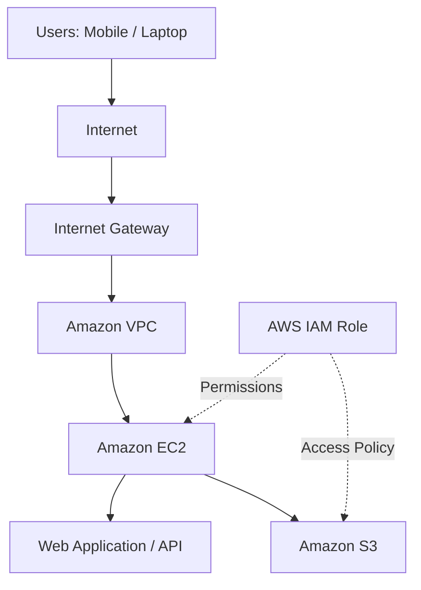

# SWYNEX Cloud Computing Internship
## Task 1: Cloud Architecture Outline

### 1. Introduction
Cloud computing provides computing resources such as servers, storage, networking and security through the internet.

This project presents a simple AWS cloud architecture for hosting a web application.

### 2. Project Objective
The main objectives are:
- Understand cloud architecture.
- Identify AWS computing services.
- Understand cloud storage.
- Understand cloud networking.
- Implement basic cloud security concepts.

### 3. AWS Services Used

#### A. Compute - Amazon EC2
Amazon Elastic Compute Cloud (EC2) provides virtual servers in the cloud.

Purpose:
- Runs the web application.
- Processes user requests.
- Provides computing resources.

#### B. Storage - Amazon S3
Amazon Simple Storage Service (S3) is used to store files and data.

Purpose:
- Stores images and documents.
- Provides scalable storage.
- Supports secure file access.

#### C. Networking - Amazon VPC
Amazon Virtual Private Cloud (VPC) provides an isolated network environment.

Purpose:
- Organizes cloud resources.
- Controls network communication.
- Uses subnets and security groups.

#### D. Identity and Access Management - IAM
AWS IAM manages users, roles and permissions.

Purpose:
- Controls access to AWS services.
- Provides authentication and authorization.
- Follows the principle of least privilege.

### 4. Architecture Diagram

### 5. Working Process

1. Users access the web application through the internet.
2. Internet traffic reaches the AWS network.
3. Amazon EC2 runs the web application.
4. The application processes user requests.
5. Amazon S3 stores application files.
6. IAM controls access permissions.
7. VPC provides network isolation and security.

### 6. Security Considerations

- Use IAM roles instead of storing access keys in application code.
- Apply least-privilege permissions.
- Use security groups to restrict network traffic.
- Keep S3 buckets private unless public access is specifically required.
- Use HTTPS to protect communication.

### 7. Benefits

- Scalability
- Flexibility
- Cost efficiency
- High availability when designed appropriately
- Improved access control

### 8. Conclusion

This project explains a basic cloud architecture using AWS services such as EC2, S3, VPC and IAM.

It provides an understanding of how cloud computing services work together to host and secure a web application.

### 9. Tools and Technologies

- Amazon Web Services (AWS)
- Amazon EC2
- Amazon S3
- Amazon VPC
- AWS IAM
- GitHub
- Markdown
